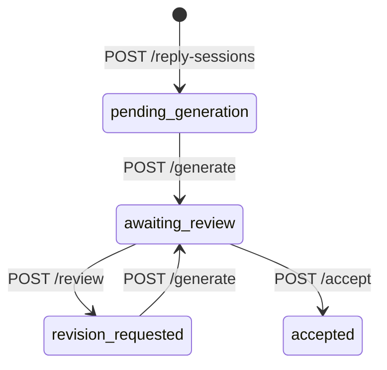

# Frontend API Contract

This contract describes the implemented HTTP API in `main.py`, the wire models
in `src/models.py`, and the session behavior in `src/reply_sessions.py` as of
2026-09-18. It describes current behavior, including integration limitations;
it does not propose additional endpoints.

## Connection and conventions

| Item | Contract |
| --- | --- |
| Local base URL | `http://127.0.0.1:8000` |
| Deployment base URL | Supplied by the deployment; no `/api` or `/v1` prefix in application routes |
| Transport | HTTP request/response; no SSE, WebSocket, or token streaming |
| Request headers | `Content-Type: application/json` for JSON bodies; `Accept: application/json` recommended |
| Request correlation | Optional `X-Request-ID` with 1–128 letters, digits, dots, underscores, or hyphens; invalid or missing values are replaced. Handled responses include the request ID in `X-Request-ID` |
| Response format | JSON, including the health response |
| Authentication | No authentication or authorization implemented in the application |
| Identity | `user_id` and `course_id` are caller-supplied data, not verified credentials |
| CORS | No CORS middleware configured; use a same-origin frontend proxy or configure CORS before cross-origin browser integration |
| Naming | JSON fields use `snake_case` |
| Unknown fields | Rejected with HTTP `422` in request models |
| Pagination | Not applicable; there is no session-list endpoint |

All operations finish within the HTTP request. Generation can involve multiple
external calls; there is no application-level completion-time guarantee, job ID,
progress endpoint, or server-side cancellation API. Keep a loading state until
the request resolves. A browser abort does not guarantee cancellation of backend
work.

The MCP adapter applies its own configurable tool execution deadline. This does
not add a deadline to direct HTTP requests. Application logs correlate requests
and dependency operations without logging request/response bodies; see the
[observability guide](../README.md#observability).

Machine-readable schema: [openapi.json](openapi.json), exported directly from
`app.openapi()`. A running service exposes `/openapi.json`, `/docs`, and `/redoc`.
The export preserves FastAPI's current schema exactly, including the local
development server URL, operation IDs, route tags, and declared session errors
such as `404`, `409`, and `503`. Session errors use `HTTPErrorResponse` with a
string `detail`. Check the running service's schema when integrating a different
revision.

## Endpoint summary

Every reply belongs to a session and supports feedback and repeated revision
before acceptance. The direct `POST /reply` endpoint has been removed. Existing
clients must create a session with `POST /reply-sessions`, keep its
`conversation_id`, and call its `/generate` operation.

`{conversation_id}` is an opaque string returned by session creation. URL-encode
it when building paths. Do not assume a UUID or a particular prefix.

| Method | Path | Request body | Success | Known errors |
| --- | --- | --- | --- | --- |
| GET | `/health` | None | `200`, JSON string | — |
| POST | `/reply-sessions` | `CreateReplySessionRequest` | `201`, `ReplySession` | `422`, `503` |
| GET | `/reply-sessions/{conversation_id}` | None | `200`, `ReplySession` | `404` |
| POST | `/reply-sessions/{conversation_id}/generate` | None | `200`, `ReplySession` | `404`, `409`, `503` |
| POST | `/reply-sessions/{conversation_id}/review` | `ReviewReplySessionRequest` | `200`, `ReplySession` | `404`, `409`, `422` |
| POST | `/reply-sessions/{conversation_id}/accept` | None | `200`, `ReplySession` | `404`, `409`, `503` |

For endpoints with no body, omit the body. Infrastructure failures can also
produce other HTTP statuses or non-JSON responses.

## Wire models

These TypeScript definitions describe frontend requests and JSON responses.
Optional request properties may be omitted. Nullable response properties are
serialized as `null` when unset.

```ts
export type SessionStatus =
  | "pending_generation"
  | "awaiting_review"
  | "revision_requested"
  | "accepted";

export interface CreateReplySessionRequest {
  question: string; // Minimum length: 1.
  course_id: string; // Minimum length: 1.
  user_id?: string | null; // Defaults to null.
}

export interface ReviewReplySessionRequest {
  feedback: string; // Minimum length: 1.
}

export interface Revision {
  revision_number: number; // Integer >= 1.
  feedback: string | null;
  revision_content: string | null;
}

export interface ReplySession {
  conversation_id: string;
  course_id: string;
  user_id: string | null;
  student_query: string; // The question submitted during creation.
  status: SessionStatus;
  revisions: Revision[]; // Ordered oldest to newest.
}
```

The backend does not trim whitespace or impose maximum lengths on these
strings. Session creation requires nonempty `question` and `course_id`;
revision requests require nonempty `feedback`. The frontend should validate
meaningful, nonblank user input.

## Teacher review workflow

### State transitions



| Current status | Allowed mutating actions | Suggested UI |
| --- | --- | --- |
| `pending_generation` | Generate | Generate draft |
| `awaiting_review` | Review, accept | Show draft, request changes, accept |
| `revision_requested` | Generate | Show feedback, generate revision |
| `accepted` | None | Show accepted answer |

`GET` is available in every state. There is no `generating` or `failed` session
state; track in-flight requests locally and disable competing actions. State
checks are not a concurrency-control mechanism: serialize mutations per session.

### 1. Create: `POST /reply-sessions`

Request:

```json
{
  "question": "When is Assignment 1 due?",
  "course_id": "COSC1234-2026-S2",
  "user_id": "student-123"
}
```

Response (`201`):

```json
{
  "conversation_id": "conv_example",
  "course_id": "COSC1234-2026-S2",
  "user_id": "student-123",
  "student_query": "When is Assignment 1 due?",
  "status": "pending_generation",
  "revisions": []
}
```

Creation allocates a conversation but does not generate an answer. It can call
an external conversation service and fail with `503`. Save the returned
`conversation_id` to address subsequent requests. There is no supported update
to the original question, course, or user after creation.

### 2. Generate: `POST /reply-sessions/{conversation_id}/generate`

No body. From `pending_generation`, generates the first answer and returns the
full session with `status: "awaiting_review"` and:

```json
"revisions": [
  {"revision_number": 1, "feedback": null, "revision_content": "Initial draft answer."}
]
```

From `revision_requested`, fills the latest pending revision's
`revision_content` and returns to `awaiting_review`. Revision generation uses
existing conversation/session context; it does not run fresh intent
classification and retrieval.

Only `ReplyResponse.reply` is stored in a session. The answer-level `status` and
`citations` are discarded, including on the first generation. Consequently,
`awaiting_review` does not imply the answer was classified as `answered`.
The frontend cannot obtain structured citations for a session through this API.

### 3. Request changes: `POST /reply-sessions/{conversation_id}/review`

Requires `awaiting_review`. Request:

```json
{"feedback": "Make the answer shorter and include the late penalty."}
```

Returns the full session with `status: "revision_requested"`. It appends a
pending revision; it does not generate the revised answer:

```json
"revisions": [
  {"revision_number": 1, "feedback": null, "revision_content": "Initial draft answer."},
  {
    "revision_number": 2,
    "feedback": "Make the answer shorter and include the late penalty.",
    "revision_content": null
  }
]
```

Call `/generate` next. Keep displaying the latest non-null `revision_content`
while a new revision is pending. The feedback belongs to the revision it asks
the backend to generate, not to the previous entry. The API does not support
editing feedback, directly submitting an edited answer, or selecting an older
revision for acceptance.

### 4. Accept: `POST /reply-sessions/{conversation_id}/accept`

No body. Requires `awaiting_review`. Persists the original question and latest
answer as course-scoped historical Q&A, then returns the full session with
`status: "accepted"`. Embedding generation and Cosmos DB persistence happen
before the state changes. On persistence failure, the endpoint returns `503`
and the session remains `awaiting_review` in the ordinary sequential flow.

Acceptance applies to the latest generated revision. Calling `/accept` again
after success returns `409`; there is no reopen or undo endpoint. Acceptance
does not send the answer to a student or publish a message elsewhere.

### Retrieve: `GET /reply-sessions/{conversation_id}`

Returns the current full session (`200`), or `404` if it is unknown to this
process. It does not trigger generation. Use it to refresh UI state or reconcile
an uncertain mutation outcome after a timeout.

Sessions are held in process memory, lost on restart, and not shared between
workers or replicas. Persisting an accepted Q&A does not make the session
retrievable after restart. A deployment serving this workflow needs requests
to reach the same process; otherwise subsequent requests can return `404`.
There is no list, delete, export, chat-message append, or session recovery API.

## Errors and retry behavior

### Session errors

Session errors use `{"detail": "..."}`:

| HTTP status | Endpoint/action | Exact `detail` |
| --- | --- | --- |
| `404` | Any operation on an unknown session | `Reply session not found` |
| `409` | Generate in an invalid state | `Session is not ready for generation` |
| `409` | Review or accept outside `awaiting_review` | `Session is not awaiting review` |
| `409` | Revision helper detects an invalid state | `Session has no revision request` |
| `503` | Create | `The service could not create a session` |
| `503` | Generate | `The service could not generate a reply` |
| `503` | Accept | `The service could not accept the reply` |

The revision-helper conflict is a defensive check and is not expected during a
serialized valid workflow. Do not rely on every exception producing this
envelope: there is no global custom error handler.

### Request validation

Missing required fields, forbidden extra fields, null for a
non-nullable field, and empty strings with a minimum length produce HTTP `422`.
Representative response for an empty `question`:

```json
{
  "detail": [
    {
      "type": "string_too_short",
      "loc": ["body", "question"],
      "msg": "String should have at least 1 character",
      "input": "",
      "ctx": {"min_length": 1}
    }
  ]
}
```

Treat `detail` as a string or a validation-error array. Validation entries have
`loc`, `msg`, and `type`, and may contain additional properties; do not match the
entire human-readable error message to drive frontend logic.

### Recovery guidance

- `422`: Correct the indicated input before retrying.
- `404`: Inform the user the session is unavailable and allow explicit creation
  of a new session; do not assume the ID can be recovered from historical Q&A.
- `409`: Fetch the session and update available actions to match its state.
- `503` or a network timeout: Show an actionable failure. For session mutations,
  fetch the session before deciding whether to repeat the action.

There are no idempotency keys, conditional writes, or automatic deduplication
for HTTP operations. Creation retries can create additional sessions. A request
may have completed even if the browser never received its response. Historical
Q&A storage uses a deterministic upsert ID internally, but this does not make
`POST /accept` idempotent at the HTTP contract level.

## Minimal frontend request helper

This example creates a reply session, generates a draft, and requests a revision.
Type parameters describe expected JSON; they do not perform runtime schema
validation.

```ts
export class ApiError extends Error {
  constructor(public status: number, public payload: unknown) {
    super(`API request failed (${status})`);
  }
}

export async function requestJson<T>(
  baseUrl: string,
  path: string,
  options: { method?: "GET" | "POST"; body?: unknown; signal?: AbortSignal } = {},
): Promise<T> {
  const response = await fetch(`${baseUrl.replace(/\/$/, "")}${path}`, {
    method: options.method ?? "GET",
    headers: {
      Accept: "application/json",
      ...(options.body === undefined ? {} : { "Content-Type": "application/json" }),
    },
    body: options.body === undefined ? undefined : JSON.stringify(options.body),
    signal: options.signal,
  });
  const text = await response.text();
  let payload: unknown = text;
  try { payload = JSON.parse(text); } catch { /* Preserve non-JSON proxy errors. */ }
  if (!response.ok) throw new ApiError(response.status, payload);
  return payload as T;
}

// The base URL may instead be a same-origin proxy prefix configured by the app.
const baseUrl = "http://127.0.0.1:8000";
const created = await requestJson<ReplySession>(baseUrl, "/reply-sessions", {
  method: "POST",
  body: { question: "What is due this week?", course_id: "c1" },
});
const sessionPath = `/reply-sessions/${encodeURIComponent(created.conversation_id)}`;
const generated = await requestJson<ReplySession>(baseUrl, `${sessionPath}/generate`, {
  method: "POST",
});
// Display generated.revisions and collect feedback before requesting a revision.
const reviewed = await requestJson<ReplySession>(baseUrl, `${sessionPath}/review`, {
  method: "POST",
  body: { feedback: "Make the answer shorter." },
});
const revised = await requestJson<ReplySession>(baseUrl, `${sessionPath}/generate`, {
  method: "POST",
});
```

Handle fetch network/abort exceptions separately from `ApiError`. For a session
screen, replace local server data with each successful full-session response.

## Health check

`GET /health` returns HTTP `200` with JSON body `"running well"` (a JSON string,
not an object). It confirms the application responds; it does not check the LLM,
retrieval sources, embeddings, or Cosmos DB.

## Maintaining this contract

Regenerate the unmodified OpenAPI snapshot from the repository root after route
or model changes:

```bash
uv run python - <<'PY'
import json
from pathlib import Path
from main import app

Path("docs/openapi.json").write_text(json.dumps(app.openapi(), indent=2) + "\n")
PY
```

Update this document and the route metadata when runtime behavior changes,
especially session state transitions and error responses.
